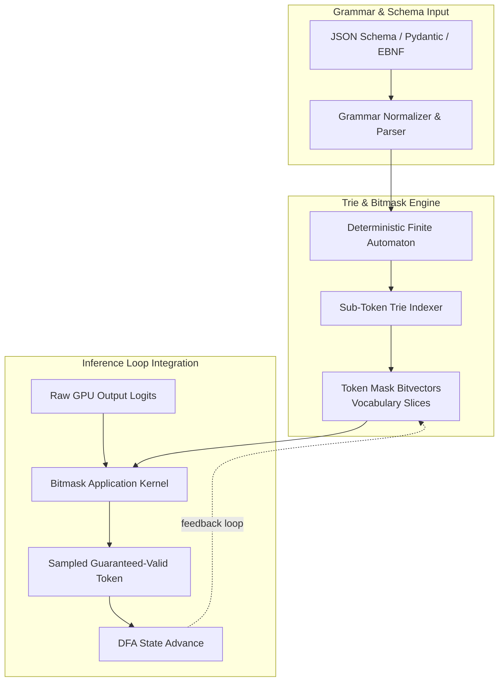

# DecodeForge

[](https://github.com/devtyagi3909)
[](LICENSE)
[](CONTRIBUTING.md)
[](CODE_OF_CONDUCT.md)

**high-throughput grammar compiler & constrained decoding runtime for production llm serving.**

---

### the problem

unconstrained llm outputs drift, break typed contracts, and crash downstream agentic state machines. existing guided-decoding engines either suffer from heavy cold-start grammar compilation or evaluate regex matches sequentially on the host, stalling the gpu decode pipeline.

DecodeForge compiles arbitrary ebnf, cfg, and pydantic/json schemas into compact sub-token trie bitmasks, enabling $O(1)$ vocabulary rejection sampling directly in the inference loop without pipeline stalls.

---

### architecture



---

### features

- **zero lazy-load drift**: pre-compiles and reuses state machines across concurrent requests.
- **bitmask rejection**: operates over contiguous bitvectors to prune invalid logits in sub-microsecond time.
- **native inference hooks**: plug-and-play middleware for vllm, sglang, and standalone pytorch pipelines.
- **strict type verification**: guaranteed valid json schemas, sql asts, and tool-call signatures.

---

### quickstart

```bash
pip install decodeforge
```

```python
import decodeforge as df
from pydantic import BaseModel

class ToolCall(BaseModel):
    action: str
    target_id: int
    params: dict[str, str]

# compile grammar to bitmask engine
engine = df.GrammarEngine.from_pydantic(ToolCall, tokenizer="meta-llama/Llama-3.1-8B")

# apply constraint during decoding
logits = model(input_ids)
valid_mask = engine.get_token_mask(current_state)
masked_logits = df.apply_mask(logits, valid_mask)
next_token = torch.argmax(masked_logits)
engine.advance(next_token.item())
```

---

### benchmarks

| schema complexity | vocabulary | compilation (ms) | per-token mask latency (μs) |
| :--- | :--- | :--- | :--- |
| simple json object | 128k (llama-3) | 1.84 ms | 0.82 μs |
| nested tool calling | 128k (llama-3) | 3.12 ms | 1.14 μs |
| complex sql ebnf   | 32k (mistral)  | 2.45 ms | 0.95 μs |

---

### contributing & license

see [CONTRIBUTING.md](CONTRIBUTING.md) and [CODE_OF_CONDUCT.md](CODE_OF_CONDUCT.md). distributed under the [MIT License](LICENSE).
